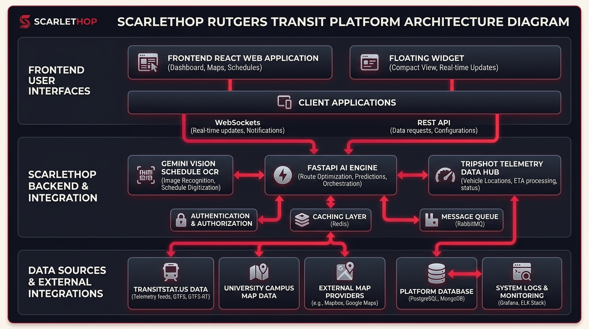

# Project Name - Tagline / Catchphrase

**Project Name** is an end-to-end platform that enables [target users] to collaboratively [primary goal or key value proposition].  
By combining [technology/feature 1], [technology/feature 2], and intuitive dashboards, the system helps users [key benefit] while providing [secondary benefit or insights].

---

## Screen Shot / Demo


---

## System Overview

Project Name consists of three main layers:

1. **Frontends**
   - **Admin / Management Dashboard:** Built with Next.js, TypeScript, and Tailwind CSS. Used for configuration, management, and viewing analytics.
   - **Client / User Portal:** Built with React, TypeScript, Vite, and Tailwind CSS. Provides an intuitive interface for end users to interact with the platform.

2. **Core Processing Service**
   - Powered by FastAPI / Node.js and relevant AI/processing libraries.
   - Handles data transformation, background task execution, and core business logic.
   - Converts raw user inputs into structured assets and actionable insights.

3. **Data & Storage Service**
   - Built on modern cloud storage and relational/document databases.
   - Stores processed assets, metadata, user state, and system analytics.
   - Acts as the central hub for managing data access, retrieval, and persistence.

---

## Data Flow



| Step | Communication | Description |
|------|----------------|-------------|
| 1 | Client Frontend → Processing Service | Requests and input data are submitted for processing. |
| 2 | Processing Service → Storage / Database | Processed data and generated assets are structured and persisted. |
| 3 | Storage / Database → Admin Dashboard | Analytics, system metrics, and records are retrieved for management. |
| 4 | Storage / Database ↔ Client Frontend | Delivers processed content to end users and records interaction feedback. |

---

## Core Features

### Management / Admin Portal
- Manage project assets and user configurations.
- Trigger and monitor automated background workflows.
- Access real-time analytics and system reporting.

### User / Client Portal
- Clean, responsive interface for core user interactions.
- Real-time updates and interactive feedback.
- Personalized workflows tailored to user input.

---

## Technologies

| Category | Stack |
|-----------|--------|
| **Frontend** | React, Next.js, TypeScript, Tailwind CSS, Vite |
| **Backend** | FastAPI / Node.js, REST APIs, WebSockets |
| **AI & Processing** | Multimodal AI Models, Data Processing Pipelines |
| **Database & Cloud** | PostgreSQL / MongoDB, Cloud Storage |
| **DevOps & Tooling** | Docker, Git, CI/CD Pipelines |

---

## Getting Started

### Prerequisites
- Node.js (v18+)
- Python (3.10+)
- Package manager (npm / pnpm / yarn)

### Setup & Run
```bash
# Clone the repository
git clone https://github.com/AbinavRamasamy/HackRU_F26.git
cd HackRU_F26

# Install dependencies and start development servers
# (Add your specific startup commands here)
```

---

## Mission

**Project Name** combines modern technology and thoughtful design to solve [problem statement] — empowering users with tools that make [key task] seamless, efficient, and accessible.
